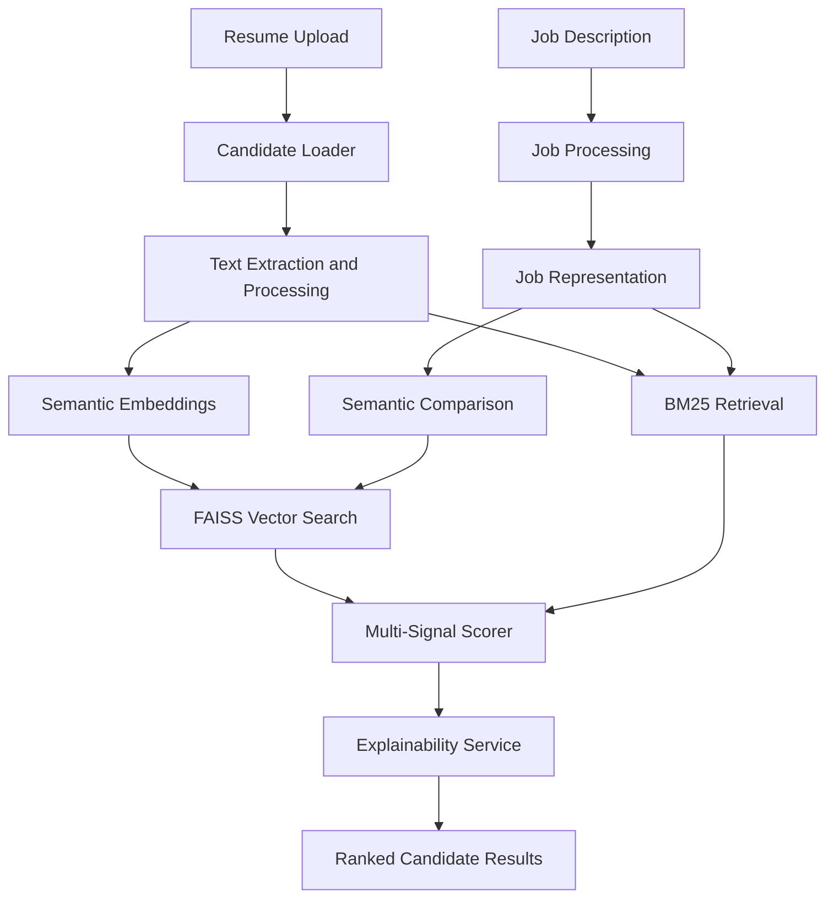

# AI Resume Ranking System
### Beyond Keywords. Intelligent Hiring with Semantic AI.

An AI-powered resume screening and ranking platform that helps recruiters identify the most relevant candidates by analyzing skills, experience, qualifications, and semantic similarity between resumes and job descriptions.

Unlike traditional keyword-based screening systems, this project combines **Semantic Search, Natural Language Processing (NLP), and Multi-Signal Scoring** to evaluate candidate-job compatibility more intelligently.

---

## Table of Contents

- [Overview](#-overview)
- [Problem Statement](#-problem-statement)
- [Key Features](#-key-features)
- [How It Works](#-how-it-works)
- [System Architecture](#-system-architecture)
- [Technology Stack](#-technology-stack)
- [Project Structure](#-project-structure)
- [Core Modules](#-core-modules)
- [Matching and Ranking Approach](#-matching-and-ranking-approach)
- [Installation and Setup](#-installation-and-setup)
- [Application Workflow](#-application-workflow)
- [API Documentation](#-api-documentation)
- [Testing](#-testing)
- [Future Enhancements](#-future-enhancements)
- [Contributing](#-contributing)
- [License](#-license)

---

## 🚀 Overview

The AI Resume Ranking System is a full-stack recruitment intelligence application designed to automate and improve the initial stages of candidate screening.

Recruiters often receive hundreds or thousands of resumes for a single job opening. Manually reviewing each resume is time-consuming and makes it difficult to consistently identify candidates whose qualifications genuinely match the job requirements.

This project addresses that challenge through an intelligent resume analysis and ranking pipeline.

The system processes resumes, extracts relevant candidate information, generates semantic representations, retrieves relevant candidates, and evaluates their suitability against a given job description.

It combines multiple techniques:

- NLP-based resume understanding.
- Sentence Transformer embeddings.
- FAISS-based similarity search.
- BM25-based keyword relevance.
- Multi-signal candidate scoring.
- Explainable candidate evaluation.

**The primary objective is to move beyond simple keyword matching and make candidate discovery more context-aware, efficient, and transparent.**

---

## 🎯 Problem Statement

Traditional resume screening systems often depend heavily on exact keyword matching.

For example:

A job description requires:

`Machine Learning, Python, Data Analysis`

A candidate resume mentions:

`Predictive Modeling, Python Programming, Statistical Analysis`

A basic keyword-based system may fail to recognize the relationship between these terms, even when the candidate possesses relevant skills.

### Our Solution

The proposed system combines semantic understanding and keyword-based retrieval to identify candidates based on contextual relevance.

It evaluates resumes using multiple signals rather than relying on a single matching technique.

This helps improve candidate discovery and provides recruiters with more meaningful ranking information.

---

## ✨ Key Features

### 1. Resume Processing
- Upload and process candidate resumes.
- Extract textual information from supported resume formats.
- Prepare resume content for downstream NLP processing.
- Organize candidate information for analysis.

### 2. Job Description Analysis
- Process job descriptions.
- Identify relevant skills, qualifications, and experience requirements.
- Generate representations for candidate-job comparison.

### 3. Semantic Resume Matching
- Generate text embeddings using Sentence Transformers.
- Understand contextual relationships between words and phrases.
- Identify relevant candidates even when exact keywords differ.

### 4. Intelligent Candidate Retrieval
- Use FAISS for efficient vector similarity search.
- Use BM25 for lexical relevance scoring.
- Combine semantic and keyword-based retrieval signals.

### 5. Multi-Signal Candidate Ranking
- Evaluate candidates using multiple relevance signals.
- Combine different scoring components.
- Generate ranked candidate results based on job requirements.

### 6. Explainable Ranking
- Provide insights into candidate-job relevance.
- Help recruiters understand the factors contributing to a candidate's ranking.
- Make the screening process more interpretable.

### 7. Full-Stack Application
- React-based frontend.
- FastAPI-powered backend.
- SQLAlchemy database integration.
- Structured service-based architecture.

---

## ⚙️ How It Works

The system follows a structured resume screening pipeline.



### Workflow Explanation

**Step 1: Resume Upload**

Candidates' resumes are provided to the system for processing.

**Step 2: Resume Parsing**

The CandidateLoader module loads candidate information and prepares resume content for analysis.

**Step 3: Job Description Processing**

The job description is processed to identify the requirements relevant to the recruitment position.

**Step 4: Semantic Embedding Generation**

Sentence Transformers convert resume and job description text into numerical vector representations.

**Step 5: Candidate Retrieval**

- FAISS retrieves semantically similar candidates.
- BM25 retrieves candidates based on lexical relevance.

**Step 6: Multi-Signal Scoring**

The MultiSignalScorer combines the available relevance signals to calculate candidate rankings.

**Step 7: Explainability**

The ExplainabilityService generates information that helps interpret the ranking results.

**Step 8: Final Ranking**

Candidates are presented in ranked order based on their evaluated relevance to the job description.

---

## 🏗️ System Architecture

The project follows a modular architecture that separates frontend presentation, backend APIs, AI processing, retrieval, and data management.

### Frontend Layer

Built using React.js and TypeScript.

Responsibilities:
- User interaction.
- Resume and job description submission.
- Displaying candidate information.
- Presenting ranking results.

### Backend Layer

Built using FastAPI and Python.

Responsibilities:
- API request handling.
- Resume processing coordination.
- AI service integration.
- Candidate ranking.
- Database operations.

### AI and Retrieval Layer

Responsible for:
- Text embedding generation.
- Semantic similarity.
- Vector retrieval.
- Keyword-based retrieval.
- Multi-signal ranking.
- Explainability.

### Database Layer

Uses SQLite and SQLAlchemy for structured data management.

---

## 🛠️ Technology Stack

| Category | Technologies |
|---|---|
| Frontend | React.js, TypeScript |
| Backend | Python, FastAPI |
| Database | SQLite |
| ORM | SQLAlchemy |
| NLP | Sentence Transformers |
| Semantic Search | FAISS |
| Keyword Retrieval | BM25 |
| Version Control | Git, GitHub |

---

## 📂 Project Structure

```text
AI-Resume-Ranking-System/
│
├── frontend/
│   ├── public/
│   ├── src/
│   └── package.json
│
├── backend/
│   ├── models/
│   ├── modules/
│   ├── parsers/
│   ├── services/
│   ├── retrieval/
│   ├── pipelines/
│   └── main.py
│
├── data/
│
├── docs/
│
├── tests/
│
├── requirements.txt
├── .gitignore
├── LICENSE
└── README.md
```

*Note: This is the proposed logical structure. Adjust folder and file names to match the actual implementation.*

---

## 🧠 Core Modules

The backend is organized into dedicated services to maintain modularity and simplify future development.

| Module | Responsibility |
|---|---|
| CandidateLoader | Loads and prepares candidate resume data |
| SemanticService | Handles semantic embedding and similarity operations |
| LLMService | Provides LLM-related processing capabilities |
| MultiSignalScorer | Combines multiple relevance signals |
| ExplainabilityService | Generates explanations for ranking results |

### CandidateLoader

Responsible for loading candidate information and preparing resume content for further processing.

### SemanticService

Handles semantic representations and similarity-based candidate matching using Sentence Transformers.

### LLMService

Provides the integration layer for LLM-related operations where configured.

### MultiSignalScorer

Combines different retrieval and relevance signals to produce candidate ranking scores.

### ExplainabilityService

Helps interpret candidate rankings by providing insights into the factors influencing the results.

---

## 🔍 Matching and Ranking Approach

One of the key aspects of this project is combining semantic and lexical retrieval.

### 1. Semantic Matching

Sentence Transformers generate dense vector representations of resumes and job descriptions.

Semantic similarity helps identify contextual relationships even when candidates use different terminology.

### 2. FAISS Vector Search

FAISS enables efficient similarity-based retrieval from candidate embeddings.

It helps identify candidates whose resume representations are close to the job description representation.

### 3. BM25 Retrieval

BM25 is a lexical ranking algorithm that evaluates relevance based on term frequency and document statistics.

It helps capture exact terminology and important keywords.

### 4. Multi-Signal Scoring

The MultiSignalScorer combines available relevance signals into a unified ranking process.

Conceptually:

`Final Score = Weighted Combination of Relevance Signals`

The actual scoring formula and weights depend on the implemented configuration.

### 5. Explainable Results

The explainability layer helps make ranking decisions easier to interpret by presenting relevant matching information.

**Important:** A ranking score represents system-estimated relevance, not a guaranteed measure of candidate quality or hiring suitability.

---

## 💻 Installation and Setup

Follow these steps to run the application locally.

### Prerequisites

Make sure you have installed:

- Python 3.10+
- Node.js and npm
- Git
- A code editor such as VS Code

### 1. Clone the Repository

```bash
git clone https://github.com/YOUR-USERNAME/ai-resume-ranking-system.git

cd ai-resume-ranking-system
```

### 2. Backend Setup

Navigate to the backend directory:

```bash
cd backend
```

Create a virtual environment:

```bash
python -m venv venv
```

Activate it.

**Windows:**

```bash
venv\Scripts\activate
```

**Linux/macOS:**

```bash
source venv/bin/activate
```

Install dependencies:

```bash
pip install -r ../requirements.txt
```

Start the FastAPI server:

```bash
uvicorn main:app --reload
```

Backend API documentation:

```text
http://127.0.0.1:8000/docs
```

### 3. Frontend Setup

Open another terminal:

```bash
cd frontend
```

Install dependencies:

```bash
npm install
```

Start the frontend:

```bash
npm run dev
```

Open the local URL displayed by Vite in your terminal.

*Note: Commands and dependency paths may need adjustment according to the actual project configuration.*

---

## 🔄 Application Workflow

1. Open the application.
2. Upload candidate resumes.
3. Provide the relevant job description.
4. Initiate the resume analysis process.
5. Allow the backend pipeline to process the submitted information.
6. Retrieve semantically and lexically relevant candidates.
7. Apply multi-signal scoring.
8. Review ranked candidates and their matching explanations.

---

## 📡 API Documentation

The backend uses FastAPI to expose application functionality through REST APIs.

Interactive API documentation is available through Swagger UI:

```text
http://127.0.0.1:8000/docs
```

API endpoints should be documented here once the backend routes are finalized.

---

## 🧪 Testing

Testing is important to ensure the reliability of individual modules and the overall ranking pipeline.

Recommended testing areas:

- Resume parsing and text extraction.
- Candidate data loading.
- Semantic embedding generation.
- FAISS retrieval.
- BM25 relevance scoring.
- Multi-signal score calculation.
- API request and response validation.
- End-to-end candidate ranking.

Run tests using:

```bash
pytest
```

*This command assumes pytest has been configured in the project.*

---

## 🔮 Future Enhancements

The project can be extended with the following capabilities:

- Support for additional resume formats.
- Advanced resume information extraction.
- Improved candidate-job matching strategies.
- Recruiter feedback-based ranking improvements.
- Advanced explainability and comparison dashboards.
- Cloud deployment and scalable infrastructure.
- Authentication and role-based access control.
- Larger-scale candidate indexing.
- Bias auditing and fairness evaluation.
- Integration with recruitment management platforms.

---

## 🔐 Responsible AI and Limitations

This system is designed as a decision-support tool for recruitment workflows, not as an autonomous hiring decision-maker.

- Candidate rankings should be reviewed by human recruiters.
- Sensitive personal information should not influence candidate evaluation.
- Ranking relevance does not establish a candidate's overall ability.
- Resume parsing and semantic matching may produce incomplete or inaccurate results.
- The system should be evaluated for fairness, consistency, and potential bias before real-world deployment.

---

## 🤝 Contributing

Contributions, suggestions, and improvements are welcome.

To contribute:

1. Fork this repository.
2. Create a new feature branch.

```bash
git checkout -b feature/your-feature-name
```

3. Make your changes.
4. Commit your changes.

```bash
git commit -m "Add: your feature description"
```

5. Push your branch.

```bash
git push origin feature/your-feature-name
```

6. Open a Pull Request.

---

## 📜 License

This project is intended for educational and development purposes.

Add an appropriate open-source license to the repository before distributing or reusing the code.

---

## 👩‍💻 Project Information

**Project Name:** AI Resume Ranking System

**Tagline:** Beyond Keywords. Intelligent Hiring with Semantic AI.

**Domain:** Artificial Intelligence | Natural Language Processing | Full-Stack Development

**Built With:** Python, React.js, TypeScript, FastAPI, Sentence Transformers, FAISS, BM25, SQLite

---

### ⭐ Support

If you find this project interesting, consider giving the repository a ⭐ on GitHub.

Your feedback and contributions are always appreciated!

**Beyond Keywords. Towards Smarter Hiring.**
